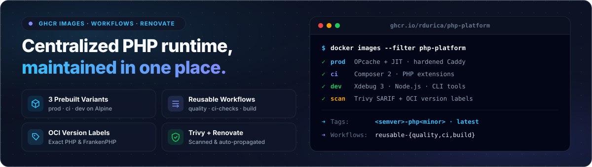
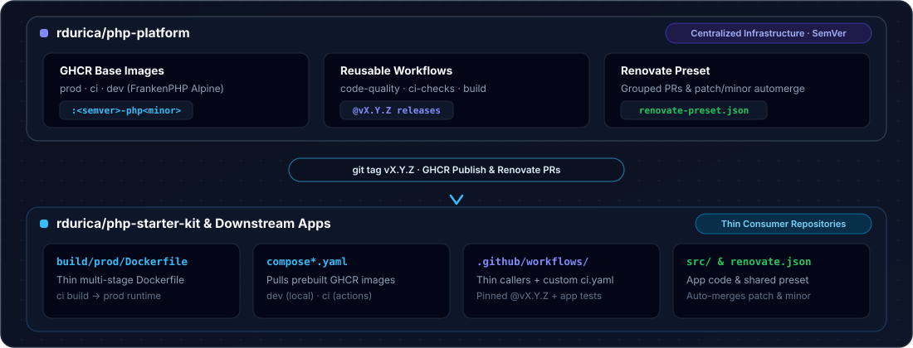

<p align="center">
  
</p>

<h1 align="center">PHP Platform</h1>

<p align="center">
  Shared <strong>FrankenPHP / PHP 8.5</strong> Docker base images, GitHub <strong>Reusable Workflows</strong>, and a shared <strong>Renovate preset</strong> for all applications created from <a href="https://github.com/rdurica/php-starter-kit"><strong>rdurica/php-starter-kit</strong></a>.
</p>

<p align="center">
  <a href="https://www.php.net/"></a>
  <a href="https://frankenphp.dev/"></a>
  <a href="https://github.com/rdurica/php-platform/actions/workflows/ci.yaml"></a>
  <a href="https://github.com/rdurica/php-platform/actions/workflows/publish-images.yaml"></a>
  <a href="LICENSE"></a>
</p>

<p align="center">
  <a href="#architecture">Architecture</a> &nbsp;·&nbsp;
  <a href="#base-docker-images-ghcr">Base Images</a> &nbsp;·&nbsp;
  <a href="#tagging-policy">Tagging Policy</a> &nbsp;·&nbsp;
  <a href="#reusable-workflows">Reusable Workflows</a> &nbsp;·&nbsp;
  <a href="#renovate-preset-renovate-presetjson">Renovate Preset</a> &nbsp;·&nbsp;
  <a href="#releasing-a-platform-update">Releasing</a>
</p>

<p align="center">
  <picture>
    <source media="(prefers-color-scheme: dark)" srcset="docs/img/banner-dark.svg">
    <source media="(prefers-color-scheme: light)" srcset="docs/img/banner-light.svg">
    
  </picture>
</p>

> [!TIP]
> **Looking to start a new PHP project?**
> Use the **[rdurica/php-starter-kit](https://github.com/rdurica/php-starter-kit)** template repository — it consumes these base images, reusable workflows, and Renovate preset out of the box.

---

## Architecture

Instead of copying Dockerfiles, Caddy configs, PHP INI settings, and CI pipelines into every application repository, shared infrastructure lives here and is consumed via versioned tags:

<p align="center">
  <picture>
    <source media="(prefers-color-scheme: dark)" srcset="docs/img/architecture-dark.svg">
    <source media="(prefers-color-scheme: light)" srcset="docs/img/architecture-light.svg">
    
  </picture>
</p>

---

## Base Docker Images (GHCR)

Published on every `v*.*.*` tag via [publish-images.yaml](.github/workflows/publish-images.yaml):

| Image | Base / Contents | Intended Use |
| --- | --- | --- |
| `ghcr.io/rdurica/php-platform/prod:<ver>` | FrankenPHP 1.12 (`php8.5-alpine`), production `php.ini` (`expose_php = Off`), OPcache (`256M`) + tracing JIT (`128M`), hardened `Caddyfile` (`admin off`, security headers, Zstd/Brotli/Gzip), `docker-entrypoint.sh` (`APP_NAME` aware, DB/Redis wait, Laravel/Symfony auto-migrations), `robbyte` user, `/up` `HEALTHCHECK` (no Composer) | Final runtime stage in app `build/prod/Dockerfile` |
| `ghcr.io/rdurica/php-platform/ci:<ver>` | FrankenPHP 1.12 (`php8.5-alpine`), PHP extensions (`pdo`, `pdo_mysql`, `mysqli`, `pdo_pgsql`, `pgsql`, `zip`, `intl`, `bcmath`, `gd`, `sockets`), `git`, Composer 2 | `vendor` build stage in prod Dockerfiles & fast CI tests |
| `ghcr.io/rdurica/php-platform/dev:<ver>` | Everything in `ci` + Xdebug 3, Node.js/npm, OpenSSH, Symfony CLI, Laravel installer (`/usr/local/bin/laravel`), baked dev `Caddyfile` (auto HTTPS + Vite HMR proxy), `entrypoint.sh` (auto-starts `npm run dev` when `node_modules` exists) | Local development via `compose.yaml` |

### Tagging Policy

Docker base images combine the platform SemVer version with a `-php<major>.<minor>` compatibility suffix (`1.1.0-php8.5`), while git tags and reusable workflow refs stay pure SemVer (`@v1.1.0`).

| Tag format | Example | Behavior |
| --- | --- | --- |
| Exact SemVer + PHP | `1.1.0-php8.5` | Immutable pin (recommended in apps for reproducible builds + Renovate PRs) |
| Minor + PHP | `1.1-php8.5` | Moves with patch releases (`1.1.x-php8.5`) |
| Major + PHP | `1-php8.5` | Moves with minor & patch releases (`1.x.x-php8.5`) |
| PHP branch | `php8.5` | Rolling latest for a PHP minor branch |
| Latest | `latest` | Latest published build of the default PHP version (`8.5`) |

Because Renovate's default Docker versioning splits tags at the first `-` (treating `php8.5` as a compatibility suffix), Renovate automatically proposes and auto-merges `1.1.0-php8.5` → `1.1.1-php8.5`, while **never** silently jumping from `-php8.5` to `-php8.6`. Upgrading an app to a newer PHP minor branch is always an explicit change (`-php8.5` → `-php8.6`).

> [!NOTE]
> **Adding a new PHP minor branch (e.g. `8.6`):** add `'8.6'` to `strategy.matrix.php` in both [.github/workflows/ci.yaml](.github/workflows/ci.yaml) and [.github/workflows/publish-images.yaml](.github/workflows/publish-images.yaml), release a new SemVer tag, and opt applications in explicitly by updating `-php8.5` → `-php8.6`.

### Exact Upstream Versions (OCI Labels)

Every published image records the exact upstream patch versions detected at build time:

```bash
docker inspect --format '{{ index .Config.Labels "dev.php-platform.php-version" }} / {{ index .Config.Labels "dev.php-platform.frankenphp-version" }}' ghcr.io/rdurica/php-platform/prod:1.1.0-php8.5
```

- `dev.php-platform.php-version` (e.g. `8.5.11`)
- `dev.php-platform.php-minor` (e.g. `8.5`)
- `dev.php-platform.frankenphp-version`

---

## Reusable Workflows

All workflows support exact version pinning (`@v1.1.0`, recommended with Renovate) or rolling major pinning (`@v1`).

### 1. Code Quality ([reusable-code-quality.yaml](.github/workflows/reusable-code-quality.yaml))

Validates Compose files, runs frontend checks (`typecheck`, `lint`, `format:check` when `src/package.json` exists), and runs backend checks (`composer validate --strict`, PHPStan, PHP CS Fixer, `composer audit` when `src/composer.json` exists).

```yaml
jobs:
  quality:
    uses: rdurica/php-platform/.github/workflows/reusable-code-quality.yaml@v1.1.0
```

| Input | Default | Description |
| --- | --- | --- |
| `node-version` | `'22'` | Node.js version for frontend checks |
| `compose-ci-file` | `'compose.ci.yaml'` | CI Compose file path |
| `run-compose-config` | `true` | Validate `compose.yaml` and CI Compose file |
| `run-frontend` | `true` | Run npm checks if `src/package.json` exists |
| `run-backend` | `true` | Run Composer/PHPStan/CS Fixer checks |

### 2. CI Checks ([reusable-ci-checks.yaml](.github/workflows/reusable-ci-checks.yaml))

Handles boilerplate CI validation (`docker compose config` and Hadolint on `build/prod/Dockerfile`) while leaving your app's `tests` job directly inside `.github/workflows/ci.yaml` so you can freely customize database services, fixtures, or test commands per app.

```yaml
jobs:
  checks:
    uses: rdurica/php-platform/.github/workflows/reusable-ci-checks.yaml@v1.1.0
```

| Input | Default | Description |
| --- | --- | --- |
| `dockerfile` | `'build/prod/Dockerfile'` | Dockerfile path to lint with Hadolint |
| `compose-ci-file` | `'compose.ci.yaml'` | CI Compose file path |
| `hadolint-ignore` | `'DL3018,DL4006,SC2028'` | Comma-separated Hadolint rules to ignore |

### 3. Production Image Build ([reusable-build.yaml](.github/workflows/reusable-build.yaml))

Multi-stage production build, GHCR push, and Trivy vulnerability scan with SARIF upload.

```yaml
jobs:
  build:
    permissions:
      contents: read
      packages: write
      security-events: write
    uses: rdurica/php-platform/.github/workflows/reusable-build.yaml@v1.1.0
```

| Input | Default | Description |
| --- | --- | --- |
| `dockerfile` | `'build/prod/Dockerfile'` | Production Dockerfile path |
| `context` | `'.'` | Docker build context |
| `registry` | `'ghcr.io'` | Target container registry |
| `push-latest` | `true` | Also push `:latest` tag |
| `trivy-scan` | `true` | Scan built digest with Trivy and upload SARIF |

---

## Renovate Preset ([renovate-preset.json](renovate-preset.json))

Applications inherit the shared preset via `renovate.json`:

```json
{
  "$schema": "https://docs.renovatebot.com/renovate-schema.json",
  "extends": ["github>rdurica/php-platform//renovate-preset"]
}
```

Behavior:

- Groups `ghcr.io/rdurica/php-platform/*` Docker image updates and `rdurica/php-platform` reusable workflow tag updates into a single **`php-platform`** PR per release.
- Enables `automerge` (when CI passes) for **`minor`**, **`patch`**, and **`digest`** updates.
- Keeps **`major`** updates (e.g., `v1` → `v2`) manual for explicit review; `-php<minor>` suffixes stay locked to their chosen PHP branch.

---

## Releasing a Platform Update

1. Make changes in `docker/` or `.github/workflows/`.
2. Open a PR or push to `main` — [Platform CI](.github/workflows/ci.yaml) lints and smoke-tests all variants across configured PHP versions.
3. Create and push a SemVer tag (e.g., `git tag -a v1.1.0 -m "v1.1.0" && git push origin v1.1.0`).
4. [Publish Base Images](.github/workflows/publish-images.yaml) builds and pushes `1.1.0-php8.5`, `1.1-php8.5`, `1-php8.5`, `php8.5`, and `latest` for `prod`, `ci`, and `dev` to GHCR, embeds exact PHP & FrankenPHP OCI labels, scans each image with Trivy, and updates the floating `v1` git tag.
5. Renovate propagates `1.1.0-php8.5` and `@v1.1.0` across all connected application repositories.

---

## Related Repositories

- **[rdurica/php-starter-kit](https://github.com/rdurica/php-starter-kit)** — Template repository for starting new Laravel, Symfony, or Nette applications on top of `php-platform`.
- **[rdurica/php_starter_kit](https://github.com/rdurica/php_starter_kit)** — Legacy monolithic starter kit (unsupported).

---

## License

This project is licensed under the terms of the [MIT License](LICENSE).
